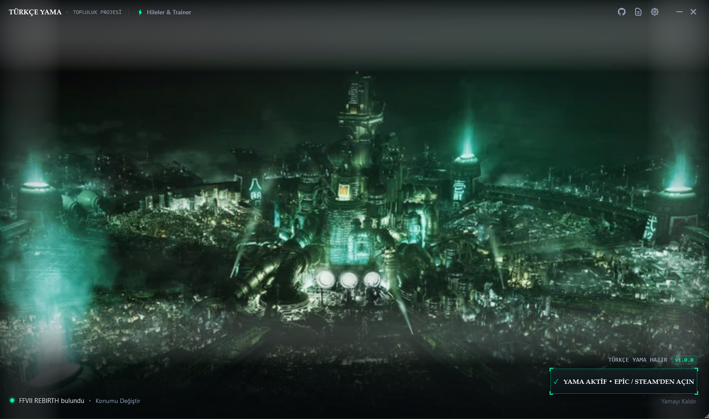
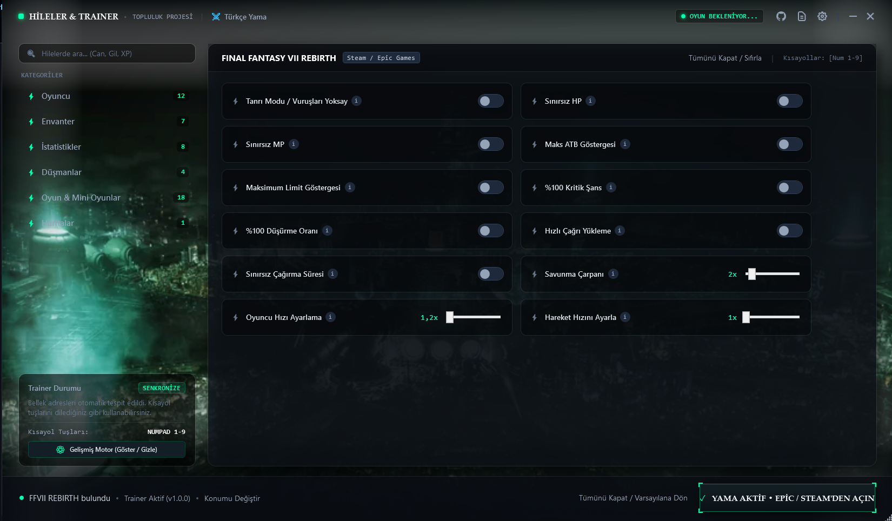

# Final Fantasy VII Rebirth - %100 Türkçe Yama & Trainer

Final Fantasy VII Rebirth (PC - Steam / Epic Games) için geliştirilmiş bağımsız yerelleştirme paketi ve 50 modüllü oyun içi hile ve trainer başlatıcısı.

**Geliştirici:** Furkan Tecir (FuTe)  
**Sürüm:** v1.0.0  
**Platform:** Windows (x64) • Steam / Epic Games  

---

## Ekran Görüntüleri

| Türkçe Yama Başlatıcısı | Hileler & Trainer Yönetimi |
| :---: | :---: |
|  |  |

---

## Öne Çıkan Özellikler

### 1. %100 Türkçe Yerelleştirme
- **Kapsam:** 49.302 satır metin eksiksiz Türkçeleştirilmiştir.
- **Hikaye ve Görevler:** Tüm ana hikaye diyalogları (Bölüm 1 - 14), yan görevler, dünya istihbaratı (World Intel) ve Chadley araştırmaları.
- **Arayüz ve Sistem:** Kullanıcı arayüzü (UI), menüler, HUD, savaş eğitimleri ve ipuçları.
- **Ekipman ve Envanter:** Eşyalar, silahlar, zırhlar, aksesuarlar ve zanaat (crafting) malzemeleri.
- **Materia ve Büyüler:** Tüm Materia açıklamaları, büyü mekanikleri ve sinerji yetenekleri.
- **Queen's Blood:** Kart oyunu kart açıklamaları, özel yetenekler ve kurallar.
- **Terminoloji Uyumu:** Final Fantasy evrenine sadık terminoloji (Cloud, Sephiroth, Mako, Materia, Shinra, Avalanche vb.).

### 2. Sıfır-Enjeksiyon (Zero-Injection) Mimarisi
- Oyunun çalıştırılabilir (`ff7rebirth.exe` / `ff7rebirth_.exe`) ikili dosyalarına veya orijinal oyun arşivlerine bayt düzeyinde müdahale edilmez.
- Unreal Engine'in yerel öncelikli mod mimarisi (`End/Content/Paks/~mods/`) kullanılır.
- Orijinal arşivler korunur; oyun güncellemelerinde dosya bozulması yaşanmaz.
- Tek tıkla tamamen orijinal durumuna geri dönülebilir (Rollback).

### 3. Gelişmiş Trainer ve Bellek Yönetimi (50 Modül)
Oyun sürecini (`ff7rebirth_.exe`) otomatik algılayan ve bellek adreslerini senkronize eden yerleşik 6 kategorili trainer:

| Kategori | Modüller |
| :--- | :--- |
| **Oyuncu** | Tanrı Modu / Vuruşları Yoksay, Sınırsız HP, Sınırsız MP, Maks ATB Göstergesi, Maksimum Limit Göstergesi, %100 Kritik Şans, %100 Düşürme Oranı, Hızlı Çağrı Yükleme, Sınırsız Çağırma Süresi, Savunma Çarpanı, Oyuncu Hızı Ayarlama, Hareket Hızını Ayarla |
| **Envanter** | Gil Düzenle, Gil Katlayıcı, Tüketilebilir Miktarını Düzenle, Malzeme Miktarını Düzenle, Moogle Madalyonları Düzenle, Altın Tüyleri Düzenle, GP'yi Düzenle, Bölgesel Veri Noktalarını Düzenle |
| **İstatistikler** | Sınırsız XP, XP Çarpanı, Sınırsız AP, AP Çarpanı, Maksimum SP, Maks Parti Seviyesi, Maks El Sanatları Seviyesi |
| **Düşmanlar** | Tek Vuruşta Sersemletme (One-Hit Stagger), Sınırsız Sersemletme Süresi, Süper Hasar / Tek Vuruşta Öldürme, Hasar Çoğaltıcı |
| **Oyun & Mini Oyunlar** | Oyun Hızı Çarpanı, Queen's Blood (Maks Skor), Hustle De Chocobo (Zamanı Dondur), Moogle Yaramazlığı (Tanrı Modu), Piyano (Mükemmel Skor), Jumpfrog (Maks Zamanlayıcı), Yunus Gösterisi, Junon Geçit Töreni (Otomatik Ritim), Fort Condor (Zaman Dondur & Sınırsız ATB), Korsanların Frenzy, Çılgın Koşu, Chocobo Yarışı (Sınırsız Enerji), G-Bike, 3D Dövüşçü (Maks ATB/Limit), Çöl Koşusu, Kaktüs Ezici, Glide De Chocobo, Dişliler ve Hamleler |
| **Haritalar** | Önemli Konuma Işınlanma (Waypoint Teleport) |

---

## Kurulum ve Kullanım

1. [Releases](https://github.com/furkantecir/FF7-Rebirth-Turkce-Yama-ve-Trainer/releases) sayfasından en güncel paketi (`FF7Rebirth_TR_Yama_Ve_Trainer_v1.0.0.zip`) indirin.
2. Zip arşivini klasöre çıkartın ve **`FF7RebirthTR.exe`** dosyasını çalıştırın.
3. Program oyunun kurulu olduğu dizini otomatik tespit edecektir (farklı bir konumdaysa sağ alttan dizini seçebilirsiniz).
4. **"TÜRKÇE YAMAYI KUR"** butonuna basarak yamayı yükleyin.
5. Oyunu **Epic Games Başlatıcısı** veya **Steam** kütüphanenizden başlatın.
6. Hileleri başlatıcı üzerindeki anahtarlardan veya oyun içerisindeyken kısayol tuşlarıyla (Numpad 1-9 vb.) kullanabilirsiniz.

---

## Proje Mimarisi

```
├── Kurulum Paketi/
│   ├── FF7RebirthTR.exe            # Bağımsız tek dosya WPF başlatıcı
│   ├── BENI OKU - KURULUM REHBERI.txt
│   └── patch/                      # Dağıtım hazır IoStore yama arşivi
│       ├── runtime_manifest.json
│       ├── z_FF7Rebirth_TR_P.pak
│       ├── z_FF7Rebirth_TR_P.ucas
│       └── z_FF7Rebirth_TR_P.utoc
├── foto/                           # Ekran görüntüleri
│   ├── Screenshot_1.png
│   └── Screenshot_2.png
├── src/
│   ├── FF7RebirthTR.Core/          # Veri modelleri ve çekirdek arayüzler
│   ├── FF7RebirthTR.Infrastructure/# Süreç algılayıcı, dosya doğrulama ve bellek servisi
│   └── FF7RebirthTR.App/           # Modern WPF kullanıcı arayüzü ve tema motoru
└── tools/
    ├── build_patch.py              # UnrealReZen IoStore derleme aracı
    └── fast_translation_engine.py  # Yerelleştirme işlem hattı
```

---

## Lisans ve Yasal Uyarı

- Bu proje eğitim, tersine mühendislik araştırması ve topluluk yerelleştirmesi amacıyla geliştirilmiş, kar amacı gütmeyen açık kaynaklı bir çalışmadır.
- Final Fantasy VII Rebirth ve ilgili tüm görsel/işitsel materyaller Square Enix Co., Ltd. mülkiyetindedir.
- Geliştirici: **Furkan Tecir (FuTe)**
